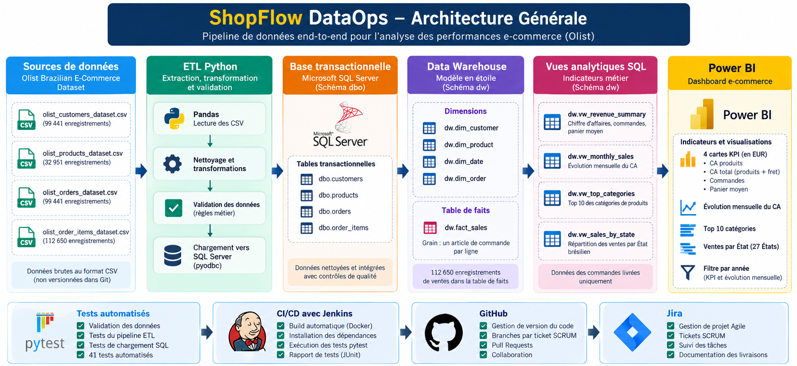
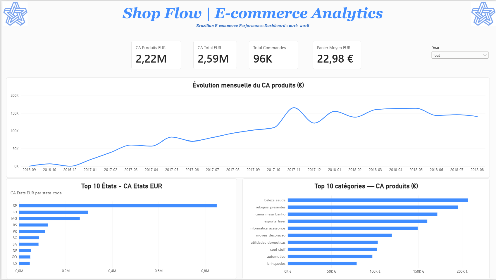

# ShopFlow DataOps
## 🏗️ Architecture Générale


### End-to-End E-commerce Data Engineering Project


## Overview

ShopFlow DataOps is an end-to-end Data Engineering portfolio project
built using the Brazilian E-Commerce Public Dataset by Olist.

The project covers the complete data lifecycle:

- Data extraction and validation with Python and Pandas
- ETL loading into Microsoft SQL Server
- Transactional database design and data quality controls
- Dimensional modeling with a star schema
- SQL analytics and business KPIs
- Automated testing with pytest
- Continuous Integration using Jenkins and Docker
- Interactive business reporting with Power BI

## Architecture

```text
Olist CSV Files
      |
      v
Python + Pandas
Data Validation
      |
      v
Microsoft SQL Server
dbo.customers
dbo.products
dbo.orders
dbo.order_items
      |
      v
Data Warehouse (dw)
dim_customer
dim_product
dim_date
dim_order
fact_sales
      |
      v
Analytical SQL Views
Revenue Summary
Monthly Sales
Top Categories
Sales by State
      |
      v
Power BI Dashboard
```

## Technologies

| Technology | Purpose |
|------------|---------|
| Python | ETL development |
| Pandas | CSV processing and transformations |
| pyodbc | SQL Server connectivity |
| SQL Server | Data storage and dimensional warehouse |
| pytest | Automated data quality and ETL tests |
| Docker | Jenkins execution environment |
| Jenkins | Continuous Integration |
| Power BI | Business Intelligence reporting |
| GitHub | Version control and collaboration |
| Jira | Agile project management |

## Dataset

Source: Olist Brazilian E-Commerce Public Dataset.

Four primary datasets are used:

| Dataset | Records |
|---------|--------:|
| Customers | 99,441 |
| Products | 32,951 |
| Orders | 99,441 |
| Order Items | 112,650 |

Raw CSV files are excluded from Git version control.

## Data Warehouse

The warehouse uses the `dw` schema in SQL Server.

### Dimensions

- `dw.dim_customer`
- `dw.dim_product`
- `dw.dim_date`
- `dw.dim_order`

### Fact Table

- `dw.fact_sales`

Grain: one order item per row.

The warehouse contains 112,650 sales fact records.

### Reconciliation

Source and warehouse values have been reconciled:

- Product amount: BRL 13,591,643.70
- Freight amount: BRL 2,251,909.54
- Total amount: BRL 15,843,553.24
- Reconciliation difference: BRL 0.00

These figures include all order statuses.

## Business Analytics

Four analytical SQL views support Power BI:

- `dw.vw_revenue_summary`
- `dw.vw_monthly_sales`
- `dw.vw_top_categories`
- `dw.vw_sales_by_state`

Delivered orders only:

| KPI | Result |
|-----|-------:|
| Delivered orders | 96,478 |
| Delivered order items | 110,197 |
| Product revenue | BRL 13,221,498.11 |
| Freight revenue | BRL 2,198,275.64 |
| Total including freight | BRL 15,419,773.75 |

## Power BI Dashboard

The ShopFlow dashboard presents:

- Product revenue in EUR
- Total revenue including freight in EUR
- Delivered order count
- Average order value
- Monthly sales evolution
- Top 10 product categories
- Sales by Brazilian state



EUR conversion uses a fixed indicative rate:
1 EUR = 5.9624 BRL.

This is a demonstration rate, not a historical transaction rate.

## Automated Testing

The project includes 41 pytest tests covering:

- Data validation
- CSV extraction and transformation
- SQL loader protections using mocks
- Transaction rollback and commit scenarios

Run the test suite:

```powershell
python -m pytest -v
```

## Continuous Integration

A Jenkins pipeline runs inside Docker and performs:

1. Environment verification
2. Python virtual environment creation
3. Dependency installation
4. Automated pytest execution
5. JUnit test reporting

The Jenkins job monitors GitHub `main` using Poll SCM.

## Repository Structure

```text
shopflow-dataops/
|
|-- data/
|   |-- raw/               # Ignored source CSV files
|
|-- src/                   # ETL and validation scripts
|-- tests/                 # Automated pytest suite
|-- sql/
|   |-- analytics/         # Transactional analytics
|   |-- warehouse/         # Warehouse DDL and ETL
|       |-- analytics/     # Warehouse analytical views
|
|-- docker/
|   |-- jenkins/
|
|-- docs/
|   |-- images/
|
|-- powerbi/
|   |-- ShopFlow_Ecommerce_Analytics.pbix
|
|-- Jenkinsfile
|-- requirements.txt
|-- pytest.ini
|-- README.md
```

## Project Highlights

- End-to-end pipeline from CSV to dashboard
- SQL Server transactional and dimensional modeling
- Centralized data validation
- Financial reconciliation between source and warehouse
- Automated CI testing with Docker and Jenkins
- Power BI reporting with EUR-converted business indicators
- Agile delivery with Jira tickets and GitHub Pull Requests

## Author

Developed as a hands-on Data Engineering portfolio project.
```
